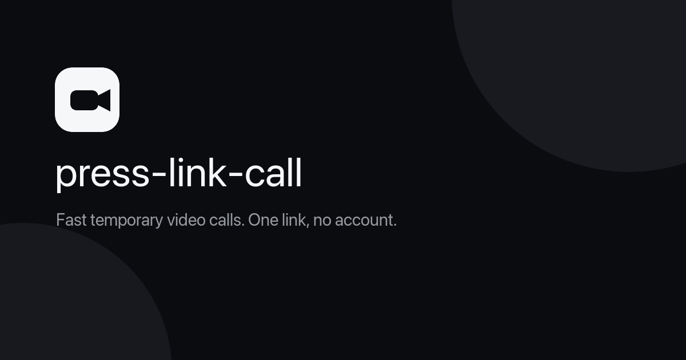

# press-link-call



> [!IMPORTANT]
> This project has been discontinued. The live Cloudflare deployment, Worker, Durable Object, and MoQ Relay have been deleted; the hosted application is no longer available. This repository is preserved as a technical experiment.

Temporary, passwordless audio and video calls over Media over QUIC. The implementation includes the complete call flow, secure invite links, a Cloudflare Worker, and a SQLite-backed Durable Object for temporary rooms with an atomic limit of ten participants.

## Why development stopped

The experiment worked in desktop browsers but was not reliable enough on iPhone. Safari and Chrome on iOS experienced disconnects and reconnections, one-way audio/video streams, and `Track not found` subscription errors. Both browsers used WebKit in the tested setup, so switching browsers did not resolve the issue.

At the time of the experiment, Cloudflare MoQ and browser WebTransport were still early technologies. A reliable product would have required moving to WebRTC/SFU, which was beyond the scope of this experiment. Development was therefore stopped, and the associated Cloudflare resources were deleted.

## Features

- Home → Create call → PreJoin → Call → Call ended.
- Invite routes: `/r/{roomId}#k={masterSecret}`.
- A 256-bit master secret generated exclusively in the browser.
- HKDF SHA-256 independently derives `authKey` and a reserved `mediaKey`.
- The Worker receives only the verifier/proof, never the `#k` fragment.
- Rooms expire after a maximum of 12 hours.
- The Durable Object atomically admits no more than 10 participants.
- Participants renew a short admission lease and release their slot when leaving.
- Media travels directly between the browser and the MoQ Relay, bypassing the Worker.
- The participant roster uses MoQ ANNOUNCE/UNANNOUNCE without polling.
- Screen sharing publishes to `{participantId}/screen.hang` and appears in a large tile.
- Camera and microphone selection before joining, with device switching during a call.
- A live preview of the selected camera before joining.
- Media and codec compatibility checks before joining, with a dedicated unsupported-browser screen.
- Automatic MoQ reconnection that preserves the desired media state, with manual reconnection once the retry window expires.
- Permission errors and unavailable devices do not prevent joining without a camera or microphone.
- An explicit Safari/iOS warning, forced experimental WebTransport, and camera orientation normalization.
- A production Content Security Policy that restricts scripts, workers, media, and network connections to the required sources.

## Local development

Requirements: Node.js 22.12+ and desktop Chrome or Edge.

```bash
npm install
cp apps/worker/.dev.vars.example apps/worker/.dev.vars
npm run dev
```

Open the URL printed by Wrangler, usually [http://localhost:8787](http://localhost:8787). `npm run dev` builds the frontend first, then starts the Worker, Durable Object, and Static Assets in the local Workers runtime.

For UI-only development, use `npm run dev:web`. In that mode, you must configure a separate proxy for the room creation API.

## Architecture

```text
Browser ── create/join/status ──> Worker ──> RoomDurableObject (SQLite)
Browser ── camera/microphone ─────────────────> MoQ Relay
```

Each public room ID maps to one Durable Object. SQLite stores room metadata, the verifier, an opaque relay namespace, and short-lived admission records. The original invite secret, media, and persistent user profiles are not stored.

During the experiment, production used a managed Cloudflare MoQ Relay. For local testing, you can explicitly set the relay URL in `.dev.vars` to `https://cdn.moq.dev/anon`; this public beta relay is not intended for production. Running your own deployment requires new Cloudflare resources and secrets.

## Checks

```bash
npm run lint
npm run typecheck
npm run test
npm run build
```

The tests cover:

- Room IDs and invite URLs.
- Base64url encoding and decoding.
- The 256-bit master secret.
- HKDF derivation of `authKey` and `mediaKey`.
- Authentication verifiers and constant-time comparison.
- Room expiration and `MAX_PARTICIPANTS`.
- Worker runtime and SQLite Durable Object integration.
- Rejection of invalid proofs.
- Atomic admission of the tenth participant, rejection of the eleventh, and slot release.

## Historical Cloudflare configuration

The deployment setup below is preserved for reference. It will not automatically restore the deleted resources: first create a new Worker/Durable Object deployment and MoQ Relay, then configure new secrets.

```bash
npx wrangler login
npm run deploy
```

The shared configuration is in `apps/worker/wrangler.jsonc`. The deployment command builds `apps/web/dist`, then publishes the API, Durable Object, and Workers Static Assets in a single Worker deployment. The SPA fallback supports opening `/r/{roomId}` directly.

At the time of implementation, SQLite-backed Durable Objects were available on Workers Free. The documented free allowances were 100,000 Worker/DO requests per day, 13,000 GB-s of DO compute per day, 5 million rows read and 100,000 rows written per day, and 5 GB of SQLite storage. Exceeding the free allowances caused operations to fail rather than incur automatic paid overages. Consult [Cloudflare Workers pricing](https://developers.cloudflare.com/workers/platform/pricing/) for current limits.

Public runtime configuration:

```json
{
  "MOQ_RELAY_URL": "https://draft-16.cloudflare.mediaoverquic.com",
  "MOQ_RELAY_ID": "press-link-call"
}
```

The relay publish/subscribe token is stored in the `MOQ_RELAY_TOKEN` Worker secret and added to the relay URL only after the invite proof has been validated. It is not included in the frontend bundle or committed to Git. The browser receives it only in the `join` response with `Cache-Control: no-store`, because draft-16 passes the relay token in the connection URL. The Cloudflare management token is never sent to the frontend. For CI, store `CLOUDFLARE_API_TOKEN` only as an environment secret.

At the time of the experiment, Cloudflare MoQ token API V1 supported only relay-wide `publish` and `subscribe` operations, without namespace- or room-scoped tokens, and each relay accepted a maximum of 10 tokens. The opaque namespace therefore protected room discovery, but a participant with a valid invite technically received a relay-wide media credential. With those limitations, rotate the token regularly with a short overlap period and use a dedicated relay for this application.

The Safari workaround is implemented by the local postinstall patch in `scripts/patch-moq-safari.mjs`. It removes the `@moq/net` safety restriction only when the application explicitly enables WebTransport for Safari. Once upstream WebKit/MoQ support is fixed, remove the patch, global flag, and Safari warning together.

## Manual verification

1. On Home, select `Start a call`.
2. On PreJoin, enter your name and select `Join call`.
3. Copy the link using `Invite someone` and verify that it contains `#k=`.
4. Open the link in nine additional tabs and join from each one.
5. Verify that the roster shows `10 / 10` and an eleventh tab receives `Call is full`.
6. Change one character after `#k=`; the application should display `Invalid invite`.
7. Select `Leave`; the media/session should close, the slot should be released, and `/call-ended` should open.

Use headphones when testing on a single computer to avoid acoustic feedback.

## Final implementation status

The final implementation used `@moq/net@0.4.0`, `@moq/room@0.2.0`, `@moq/publish@0.5.0`, and `@moq/watch@0.6.0`. No further development or maintenance is planned.
